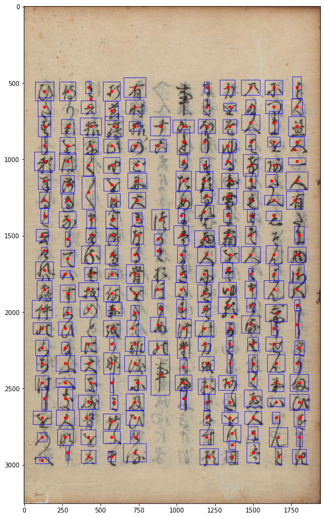
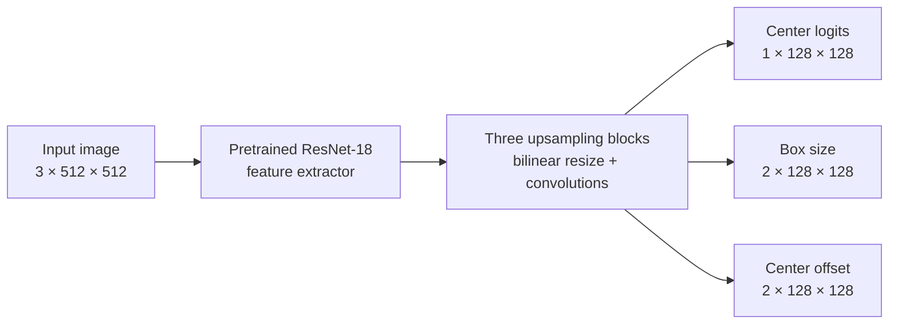
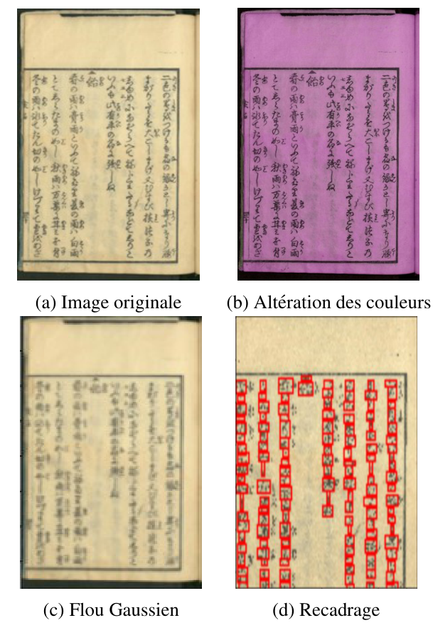
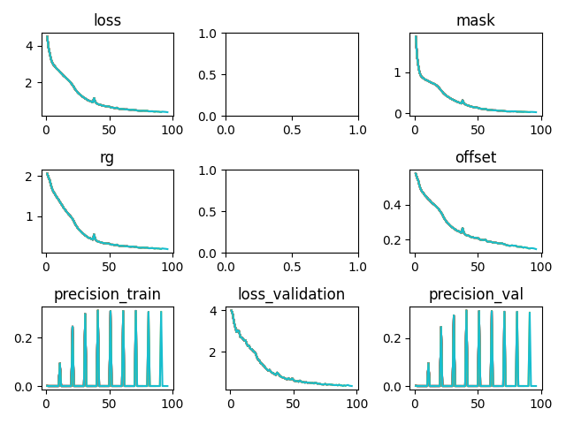
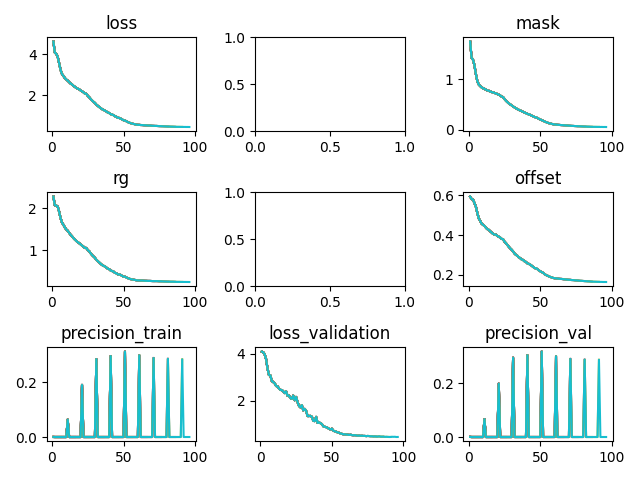
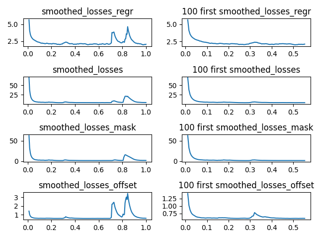

# CenterNet for Kuzushiji Character Detection

**Locating handwritten Japanese characters with an anchor-free object detector.**

A PyTorch implementation inspired by *Objects as Points*, developed for the INF8225 course project in 2021. The project adapts CenterNet to detect characters in historical Japanese documents, explores learning-rate schedules and data augmentation, and tests the approach on Pascal VOC 2007.

The focus is **detection and localization**: predicting where characters are and estimating their bounding boxes. Character transcription and classification are outside the implemented scope.

<p align="center">
  
</p>
<p align="center"><em>Kuzushiji detection example from the project report, Figure 13. This is an archived project result.</em></p>

[Project report (French)](Project_report_frenchVersion.pdf) · [Training code](ComputeCanada/) · [Experiment artifacts](Results/)

## What was built

- A compact CenterNet-style detector using an ImageNet-pretrained ResNet-18 backbone and bilinear upsampling.
- A data pipeline that turns character bounding boxes into center, size, and offset targets.
- A training objective combining modified focal loss with heatmap-weighted L1 regression losses.
- A learning-rate range test, a fixed-rate baseline, cosine warm restarts, and a One Cycle schedule.
- On-the-fly image augmentation and a separate Pascal VOC loading and annotation pipeline.
- GPU experiments submitted through Slurm on Compute Canada, with plots and job logs preserved in this repository.

## How the model works

Objects are represented by their centers. Instead of generating anchor boxes, the network predicts a center heatmap and regresses the information needed to recover each bounding box.



Each upsampling block doubles the spatial resolution and applies two convolution–batch normalization–ReLU layers. Three separate 1 × 1 convolution heads produce five output channels in total. The implementation uses bilinear interpolation in place of the original architecture's more expensive deformable upsampling operations.

For Kuzushiji, the center targets are Gaussian peaks whose spread follows the character's box dimensions. Size targets store half-width and half-height in heatmap coordinates; offset targets preserve the fractional center position lost when mapping to the smaller grid. Training sums three losses:

```text
total loss = center focal loss + box-size L1 loss + center-offset L1 loss
```

The current detector uses one foreground class. Although the VOC loader parses 20 object categories, the training and evaluation pipeline treats detections as a single class.

## Data and preprocessing

| Dataset | Purpose | Expected inputs |
| --- | --- | --- |
| Kuzushiji Recognition | Main task: character localization on scanned Japanese pages | `train.csv`, `train_images/`, and `test_images/` |
| Pascal VOC 2007 | Additional experiment on natural-image object localization | Extracted train/validation and test archives, with XML annotations or the bundled processed JSON files |

Kuzushiji annotations contain repeated `class x y width height` entries for each image. Preprocessing records the original image size and boxes, images are resized to 512 × 512, and training targets are generated at 128 × 128. Images are normalized before entering the network.

The current augmentation code applies color jitter (brightness, contrast, saturation, and hue) and Gaussian blur. The report also documents cropping experiments and a different blur configuration; those additional transformations are not all present in the committed loader.

<p align="center">
  
</p>
<p align="center"><em>Augmentation examples from the report, Figure 4. Cropping is shown as part of the reported experiments.</em></p>

Datasets and trained model weights are not included. Download and extract the data separately before training.

## Experiments and findings

The project investigated whether a lightweight CenterNet implementation could localize dense handwritten characters, how learning-rate schedules affect convergence, and whether augmentation improves generalization.

### Results reported in the project report

The following values are transcribed from Table 3 of the [report](Project_report_frenchVersion.pdf). They describe the reported experiments, which are not all reproduced by the artifacts committed under `Results/`.

| Experiment | Dataset | Learning-rate strategy | Augmentation | Epochs | Reported validation AP |
| --- | --- | --- | --- | ---: | ---: |
| KZ | Kuzushiji | Fixed, 0.001 | No | 100 | **0.32** |
| KZ-Cosine | Kuzushiji | Cosine | No | 150 | 0.13 |
| KZ-OneCycle | Kuzushiji | One Cycle | No | 100 | 0.29 |
| KZ-DA | Kuzushiji | One Cycle | Yes | 130 | 0.29 |
| PV | Pascal VOC 2007 | 0.0001, then 0.00001 after epoch 15 | No | 100 | 0.0283 |

The fixed-rate Kuzushiji baseline achieved the highest validation AP in the report. The report describes faster convergence with One Cycle, but augmentation did not improve the final reported AP. VOC was substantially harder: the discussion identifies sparse size/offset targets and large variations in object scale as difficulties, motivating patches around centers for the VOC box-size targets.

**Interpretation:** these are historical project measurements, not independently verified benchmark scores. The report states an IoU threshold of 0.5, while the committed training script calls evaluation with 0.4. The current code also has validation and box-decoding issues described below, so the scores should be read with that context.

### Training curves preserved in this repository

| Fixed learning rate: CN1 | One Cycle: CN3 |
| --- | --- |
|  |  |

The plots show total loss, center loss (`mask`), size regression (`rg`), offset loss, validation loss, and periodically recorded precision. Evaluation runs at zero-based epochs 0, 10, 20, and so on; the intervening zeros are placeholders rather than measured zero precision. The empty panels are unused subplots in the original plotting layout.

<details>
<summary><strong>Archived runs and final recorded training losses</strong></summary>

All seven Kuzushiji logs record a batch size of 20, four training data-loader workers, and 100 completed epochs. Values below come from the final completed epoch in each run's `.out` file; training loss is not a detection accuracy score.

| Run | Configuration indicated by code, filenames, and logs | Completed epochs | Final training loss | Artifacts |
| --- | --- | ---: | ---: | --- |
| CN1 | Fixed-rate baseline; learning-rate range test enabled | 100 | 0.3443 | [Browse](Results/CN1/) |
| CN1_2 | Additional fixed-rate run; range test enabled | 100 | 0.3809 | [Browse](Results/CN1_2/) |
| CN2 | Cosine warm restarts | 100 | 1.6665 | [Browse](Results/CN2/) |
| CN2_2 | Additional cosine run | 100 | 1.8968 | [Browse](Results/CN2_2/) |
| CN3 | One Cycle | 100 | 0.4562 | [Browse](Results/CN3/) |
| CN3_2 | Additional One Cycle run | 100 | 0.4236 | [Browse](Results/CN3_2/) |
| CN4 | Augmentation enabled; logged learning rate remains 0.001 | 100 | 0.4123 | [Browse](Results/CN4/) |
| VOC1 | Early VOC run; stopped during epoch 34 | 33 | 7.7939 | [Browse](Results/VOC1/) |

The CN4 archive differs from the report's One Cycle augmentation experiment. Likewise, the archived cosine runs finish at 100 epochs rather than the report's 150. The VOC1 error log records an out-of-memory kill and an evaluation-process `EOFError`; it is not the completed VOC experiment described in the report.

</details>

<details>
<summary><strong>Learning-rate range test</strong></summary>

The range test trains a separate model while increasing the learning rate across mini-batches, then plots the losses to guide schedule selection. The report selected a minimum of 0.001 for cosine scheduling and a maximum of 0.05 for One Cycle.



The committed implementation assumes 181 batches per epoch for both the range-test increment and One Cycle scheduling. That assumption must be revisited when changing the dataset or batch size.

</details>

## How Compute Canada was used

Compute Canada provided the GPU compute for the original training experiments. The source directory retains its historical name, `ComputeCanada/`; the Python training entry point can also be invoked directly on a local machine.

The [Slurm submission script](ComputeCanada/main.sh) requests:

| Resource | Request in `main.sh` |
| --- | --- |
| Nodes | 1, exclusive allocation |
| CPUs per task | 4 |
| GPU | 1 NVIDIA P100 |
| Host memory | 16 GB (`--mem=16G`) |
| Maximum job duration | 6 hours |
| Standard output and errors | Separate `output/CenterNet.<job-id>.out` and `.err` files |

The script activates a Python environment, sets training arguments, and launches `main.py`. Historically, it was submitted with `sbatch main.sh` from the code directory after configuring the account, environment, and dataset paths. The report separately lists 16 GB of GPU memory; Slurm's `--mem` setting above specifies host memory.

The archived `.out` files preserve arguments, learning rates, losses, and periodic precision values. The `.err` files preserve progress output, warnings, and failures, including a missing `conda` command in the launch scripts. These artifacts document how the original experiments ran and help explain differences between runs.

For future local runs, use the Python command below. The historical shell script still contains cluster-specific environment assumptions and is not a local launcher.

## Running locally

### 1. Prepare a Python environment

There is no pinned dependency file or recorded complete environment. The imports require PyTorch, torchvision, NumPy, pandas, OpenCV, Pillow, Matplotlib, scikit-learn, scikit-image, tqdm, and `mean-average-precision`. The following is a starting setup, rather than a verified reproduction of the 2021 environment:

```bash
python -m venv .venv
```

Activate it in PowerShell with `.\.venv\Scripts\Activate.ps1`, or on Linux/macOS with `source .venv/bin/activate`. Install a matching PyTorch/torchvision pair appropriate to your hardware, then install the remaining packages:

```bash
python -m pip install torch torchvision
python -m pip install numpy pandas opencv-python Pillow matplotlib scikit-learn scikit-image tqdm mean-average-precision
```

The script selects CUDA when available and otherwise uses the CPU. The pretrained ResNet-18 weights may download on first use. Compatibility with current library versions has not been verified; the code uses legacy torchvision and PyTorch interfaces.

### 2. Arrange the Kuzushiji data

Place the extracted data alongside the source directory:

```text
CenterNet/
├── ComputeCanada/
├── data/
│   ├── train.csv
│   ├── train_images/
│   └── test_images/
├── Results/
└── README.md
```

### 3. Start a local baseline

Run from the source directory. Keep the trailing slash on image directories: the current loaders concatenate directory strings and filenames.

```bash
cd ComputeCanada
python main.py --dataset Kuzushiji --epoch 100 --batch_size 2 --num_workers 0 --train_file ../data/train.csv --train_dir ../data/train_images/ --test_dir ../data/test_images/ --augment_data false --leslie false --scheduler None --file_name_save local_baseline
```

This uses a small training batch and no training data-loader subprocesses as a starting point for local hardware. The validation loader still hard-codes batch size 20 and six workers; adjust it in `main.py` if needed. This command has not been run end to end as part of this documentation update.

Use `python main.py --help` to see the arguments. `--leslie true` enables the additional range test; `--augment_data true` enables the committed augmentations. Scheduler choices implemented by the training loop are `None`, `cosine`, and `one_cycle`. Before using `one_cycle` on different data or batch sizes, replace the hard-coded `steps_per_epoch=181` with the actual number of training batches. The optimizers currently use hard-coded learning rates, so `--lr` does not change the training rate.

Outputs are written to the working directory: `model_<name>` (model state dictionary, overwritten each epoch), `training_log_<name>.pickle`, and `Losts_<name>.png`. Enabling the range test also produces `leslie_test_<name>.pickle` and `Leslie_lr_<name>.png`.

VOC requires additional path changes: `main.py` contains a hard-coded cluster dataset root, and it reads the Kuzushiji CSV before checking the selected dataset. It is not currently a standalone local VOC command.

## Repository guide

| Path | Contents |
| --- | --- |
| [`ComputeCanada/main.py`](ComputeCanada/main.py) | Dataset selection, training, validation, scheduling, and artifact saving |
| [`ComputeCanada/model.py`](ComputeCanada/model.py) | ResNet-18 backbone, upsampling blocks, and prediction heads |
| [`ComputeCanada/preprocess.py`](ComputeCanada/preprocess.py), [`dataloaders.py`](ComputeCanada/dataloaders.py) | Kuzushiji parsing, image loading, and augmentation |
| [`ComputeCanada/heatmaps_generation.py`](ComputeCanada/heatmaps_generation.py) | Kuzushiji center, offset, and box-size targets |
| [`ComputeCanada/VOCDataset.py`](ComputeCanada/VOCDataset.py) | VOC XML parsing, dataset loading, and target generation |
| [`ComputeCanada/loss_function.py`](ComputeCanada/loss_function.py) | Focal and regression losses |
| [`ComputeCanada/average_precision.py`](ComputeCanada/average_precision.py) | Peak extraction, box decoding, and AP calculation |
| [`ComputeCanada/leslie_experience.py`](ComputeCanada/leslie_experience.py) | Learning-rate range test and plots |
| [`ComputeCanada/args_parse.py`](ComputeCanada/args_parse.py) | Command-line arguments |
| [`ComputeCanada/main.sh`](ComputeCanada/main.sh) | Historical Compute Canada submission script |
| [`Results/`](Results/) | Archived curves, serialized logs, and Slurm output |
| [`docs/images/`](docs/images/) | Figures extracted from the project report for this README |
| [`Project_report_frenchVersion.pdf`](Project_report_frenchVersion.pdf) | Methodology, experiment discussion, results, and references |

## Reproducibility notes and next steps

This repository preserves a course-project implementation and its experimental history. A code review identifies several issues to address before interpreting a new run as a reliable benchmark:

- **Dataset separation:** the Kuzushiji training dataset uses all rows of `train`, although a 75/25 split is computed. Validation images therefore overlap the training set. Use `train_data` for training and keep validation augmentation disabled.
- **Validation behavior:** validation uses `torch.no_grad()` but never switches to `model.eval()`, so batch-normalization layers remain in training mode.
- **Box decoding and metrics:** the decoder uses the predicted center as the top-left box corner, assigns all predictions confidence 1, and modifies regression tensor views in place. Evaluation needs correction before making benchmark comparisons; the reported score is also an average of per-batch AP values.
- **Configuration and portability:** dataset paths, validation loader settings, optimizer learning rates, and schedule batch counts need to become configurable. A pinned environment and a seeded, documented data split would make experiments easier to reproduce.

Natural extensions include corrected evaluation, a clean local training interface, reproducible scheduler comparisons, and a separate character-classification stage.

## Authors and references

Developed by **Olivier Desclaux, Ralph Saber, Ghassen Cherni, and Antonin Tranchon** for INF8225.

The [project report](Project_report_frenchVersion.pdf) contains the full bibliography and discussion, including *Objects as Points* (Zhou et al., 2019), *CornerNet* (Law and Deng, 2019), Leslie N. Smith's work on cyclical learning rates and hyperparameter selection, and *KuroNet* (Clanuwat et al.). The prediction and augmentation images above are extracted from Figures 13 and 4 of that report; training and range-test plots are the original committed artifacts.
